# Muncie Kombat

A gory, over-the-top, early-90s style arcade fighting game set in Muncie, Indiana. Twenty Muncie fighters, four bosses, seventeen arenas, and a fatality for every one of them.

**Play it:** https://andyshearsphd.github.io/Muncie-Kombat/

Built for phones in landscape. It also plays in a desktop browser with a keyboard.

Warning: it is very violent and very gross.

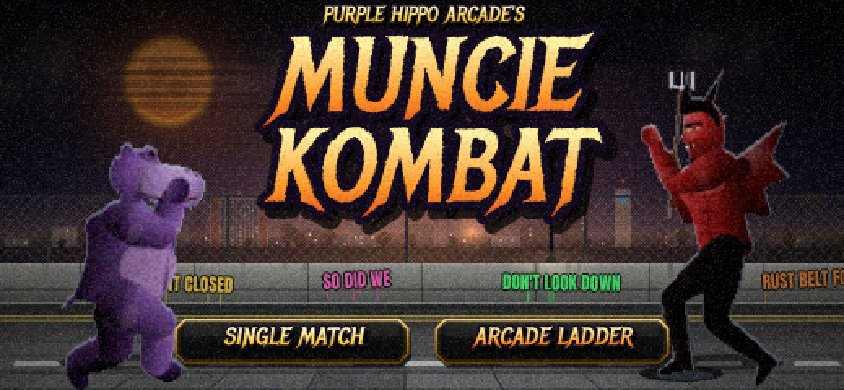

## Put it on your iPhone home screen

1. Open the link in Safari.
2. Tap the Share button.
3. Tap **Add to Home Screen**.

It then opens full screen like an app. On Android, use the browser menu and choose **Add to Home screen** or **Install app**.

## Modes

- **Arcade Ladder:** pick a fighter and climb the tower. You fight every other fighter in random order on random arenas, then the four bosses: Ofc Tinkle at City Hall, Fruit Jar Golem at the Glass Works, Slum Lord at The Rental, and Devil Dan in City Hall. That is 23 fights.
- **Single Match:** pick your fighter, your opponent and the arena. Devil Dan can only be reached through the ladder.

Matches are best of three rounds. Win the deciding round and you get FINISH HIM.

| Choose your fighter | Climb the ladder |
| --- | --- |
| 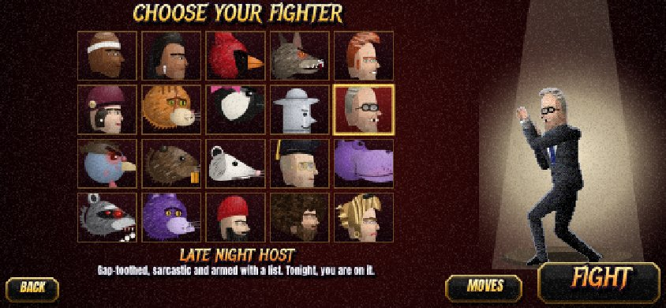 | 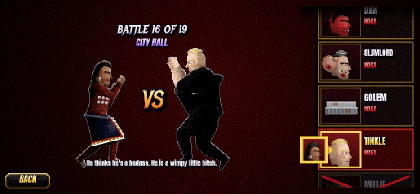 |

## Controls

On a phone, the joystick appears wherever your left thumb touches the left half of the screen. PUNCH, KICK and BLOCK are on the right.

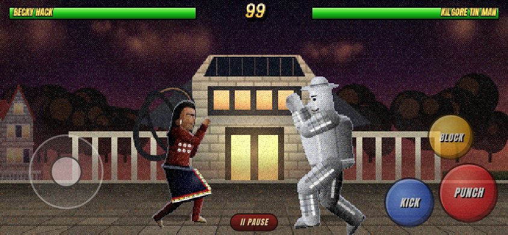

On a keyboard:

| Action | Keys |
| --- | --- |
| Move, jump, crouch | Arrow keys or WASD |
| Punch | J or Z |
| Kick | K or X |
| Block | L, C or Left Shift |
| Pause | P or Esc |

## Moves everyone has

| Input | Move |
| --- | --- |
| PUNCH | Jab (tap again for a combo) |
| DOWN + PUNCH | Uppercut |
| TOWARD + PUNCH (close) | Suplex |
| BACK + PUNCH (close) | Wad Toss |
| KICK | Kick |
| DOWN + KICK | Sweep |
| BACK + KICK | Spinning back kick |
| UP | Jump (punch or kick in the air) |
| BLOCK (hold) | Block (hold DOWN too to block low) |

### Matrix moves

| Input | Move |
| --- | --- |
| BLOCK + UP | Bullet Dodge (counters if it dodges) |
| BACK, BACK + KICK | Wall Run Flying Kick |
| In the air: DOWN + PUNCH | Hang Time |

### Special moves and finishers

| Input | Move |
| --- | --- |
| BACK, FORWARD + PUNCH | Projectile special |
| DOWN, FORWARD + KICK | Second special |
| FINISH: DOWN, DOWN + PUNCH | Fatality |
| FINISH at the Railroad Bridge, Tillotson Overpass, McCulloch Park or Cobblestone Parking Lot: DOWN + PUNCH | Stage fatality |

There may be other secrets. Every fighter's moves are also listed on the MOVES screen in the game.

## Fighters

| Fighter | Projectile | Second special | Fatality |
| --- | --- | --- | --- |
| Muncie Hippo | Poop Shot | Hippo Ram | Pothole Filler |
| Painter Dude | Palette Knife | Thinner Splash | Happy Little Accident |
| Fat Cat | Hairball | Pounce | I Hate Mondays |
| Late Night Host | Cue Card | Desk Slide | Top Ten List |
| Ballin' Well | Fireball | Alley-Oop Elbow | Posterized |
| Gertie | Wing Gust | Dive-Bomb | Honk |
| Rocky | Trash Can | Claw Roll | Rabies |
| Millie | Tail Wave | Burrow | Bone Yard |
| Chucky | Feather Darts | Dive Peck | Bird Strike |
| Mad Turkey | Leftovers | Turkey Trot | Carved |
| Coke Wolfe | Howl | Nose Candy | Full Moon |
| East End Em | Hardcover | Paper Cut | First Edition |
| Tin Man | Oil Slick | Tin Can Charge | Heartless |
| Tim Bunyon | Log Toss | Log Roll | Timber |
| Becky Hack | Shimmer | Blanket Snare | Lights Out |
| Petey | Fifty Teeth | Play Dead | Playing Possum |
| The Bearcat | Fight Song | Bearcat Maul | Spirit Week |
| Creepy Councilman | Business Card | Close Talker | Too Long a Hug |
| Pres. Never Learns | Diploma Toss | Tuition Hike | Honorary Degree |
| Walmart Karen | Expired Coupons | Finger Wag | Manager! |

| Timber | Heartless | Playing Possum |
| --- | --- | --- |
| 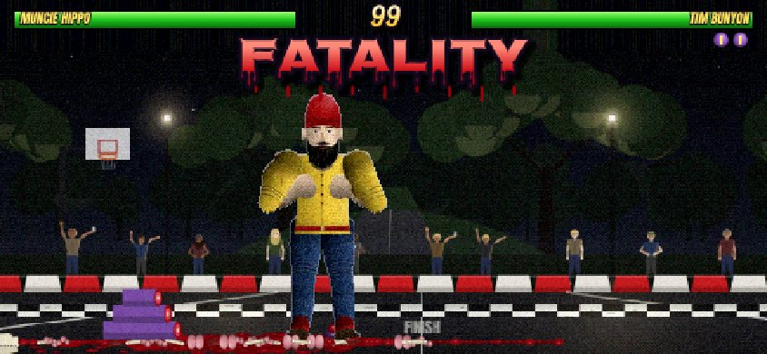 | 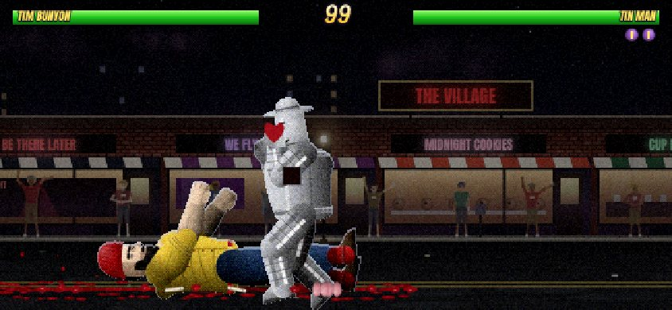 | 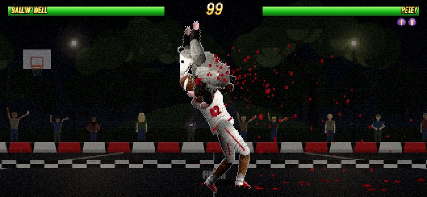 |

### Bosses

| Boss | Projectile | Second special | Fatality |
| --- | --- | --- | --- |
| Ofc Tinkle | Pepper Spray | Tackle | Use of Force |
| Fruit Jar Golem | Glass Shards | Jar Slam | Canning Season |
| Slum Lord | Eviction Notice | Late Fee | Condemned |
| Devil Dan | Hellfire | Hell Warp | Hellfire Pillar |

## Arenas

Campus, Railroad Bridge, Maxitrista, Gillespie Tower, Wysor Street Depot, Shedtown Drive-In, Cornbread Road, City Hall, The Village, Tillotson Overpass, Prairie Creek Beach, McCulloch Park, Cobblestone Parking Lot, South Wally World, plus the boss arenas: the Glass Works, The Rental and Devil Dan's City Hall.

| Prairie Creek Beach | Cornbread Road |
| --- | --- |
| 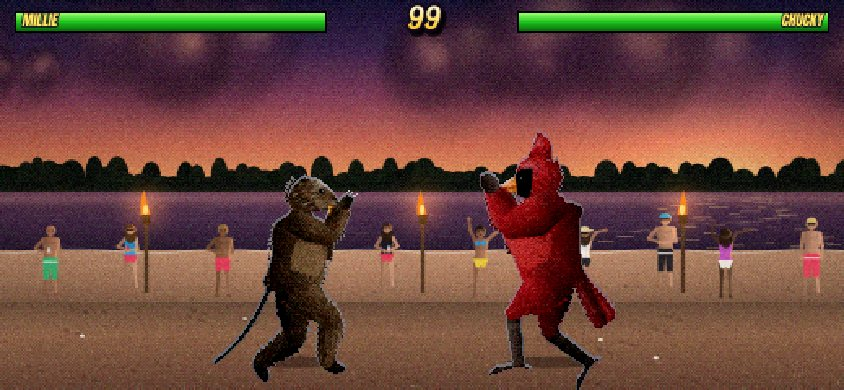 | 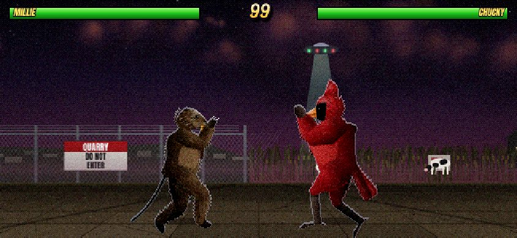 |
| **The Village** | **Railroad Bridge** |
| 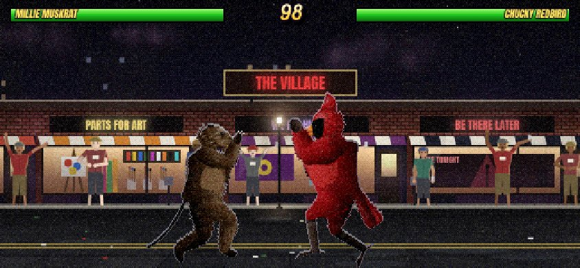 | 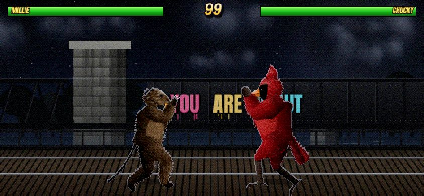 |

The Tillotson Overpass stage fatality:

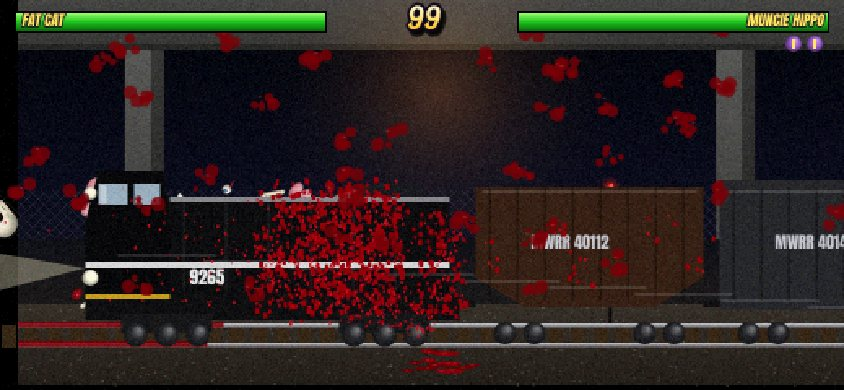

## How it is built

Plain JavaScript and the HTML canvas, with no build step and no libraries. Every fighter, arena, sound and piece of music is drawn or synthesized in code at runtime. Open `index.html` from any static web server to run it locally.

Muncie Kombat runs on the shared [Kombat Engine](https://github.com/andyshearsphd/kombat-engine). The `engine/` folder is a pinned copy of the engine (its version is in `engine/VERSION`); don't edit it here, change the engine repo and copy the new release in. Muncie Kombat's own content lives in `js/`:

| File | What it is |
| --- | --- |
| `js/fighters.js` | The sixteen fighters and four bosses |
| `js/stages.js` | The arenas |
| `js/fatalities.js` | Fatalities, stage fatalities and boss deaths |
| `js/config.js` | Titles, the hippo emblem and every victory pose |

## Credits

Fonts, all under the SIL Open Font License (license files are in `engine/fonts/`):

- **Metal Mania** by Open Window
- **Nosifer** by Vernon Adams (Typomondo)
- **Anton** by The Anton Project Authors

Muncie Kombat is a parody and a homage. It is not affiliated with or endorsed by the makers of Mortal Kombat.
